<picture>
  <source media="(prefers-color-scheme: dark)" srcset="assets/header-dark.svg">
  
</picture>

  <a href="https://berserkrush.pl"><b>berserkrush.pl</b></a>&nbsp;&nbsp;·&nbsp;&nbsp;<a href="mailto:maciej.wisniewski@aol.com">maciej.wisniewski@aol.com</a>&nbsp;&nbsp;·&nbsp;&nbsp;<a href="https://discord.com/invite/berserkrush">Discord</a>

## About

I'm 22 and I build software for digital businesses from the first conversation to production: requirements, data model, backend, frontend, mobile apps, deployment and support after launch. My strongest ground is backend architecture with Laravel and PostgreSQL.

I'm also a Computer Science engineering student specializing in **network and systems security**, and it shapes how I build: authorization lives on the server, money and items only move inside transactions, important actions leave an audit trail, and nothing is trusted just because the client sent it.

## Flagship: Berserk Rush

**[Berserk Rush](https://berserkrush.pl)** is a multiplayer browser RPG that I designed, built and operate on my own: turn-based combat, a player-driven market, guilds, a PvP arena and a 3D world map. It runs on the web, Android, iOS and Windows, with a Discord community of 300.

<picture>
  <source media="(prefers-color-scheme: dark)" srcset="assets/berserk-rush-dark.svg">
  
</picture>

- **Backend:** Laravel 12 on Octane (FrankenPHP), 32 domain modules, PostgreSQL with a hub database plus one database per game server.
- **Realtime and background work:** Reverb WebSockets for chat and live events; queue workers that run server-side expeditions and a population of bots that plays like real users.
- **Frontend:** Livewire and Alpine with Vue 3 islands; a Three.js world with a KTX2 / meshopt asset pipeline tuned for phones.
- **Apps:** Capacitor builds on [Google Play](https://play.google.com/store/apps/details?id=pl.berserkrush.app) and the [App Store](https://apps.apple.com/pl/app/berserk-rush/id6817840892) (in-app purchases, Sign in with Apple, push notifications), an Electron launcher for Windows and a discord.js bot linked to game accounts.
- **Open data:** a documented, read-only REST API (`/api/v1`) with scoped tokens for guild leaders.
- **AI:** an in-game wiki assistant built on the Claude API.
- **Quality:** 2,400+ Pest tests, k6 load tests, 97 module docs, 5 languages.

The source is private because the game is a live commercial product. I'm happy to walk through the code in an interview.

## Products for businesses

| Product | What it does | Built with |
|---|---|---|
| **[Client Reminder](https://github.com/KenjiWriter/client-reminder-app)** | **Client project delivered for Fundacja Centrum Pro Bono.** Appointment portal for small clinics: drag-and-drop calendar, online booking with approval, automatic SMS confirmations and 24 h reminders, client medical card with risk flags, two-way Google Calendar sync, built-in mail client. | Laravel 12, Inertia, Vue 3, TypeScript |
| **[IT Helpdesk](https://github.com/KenjiWriter/helpdesk-it)** | Internal IT service desk: an employee portal plus a control center for technicians, a strict ticket lifecycle, read-only audit trail, SLA and workload reporting, 2FA. | Laravel 12, Livewire 4, Filament 5 |
| **[QrMe](https://github.com/KenjiWriter/QrMe)** | Digital business cards for teams: a mobile-first page and a QR code for every employee, scan tracking that counts real scans only, one-tap vCard save, PL / EN. | Laravel 13, Vue 3, Tailwind 4 |
| **[Neighborly](https://github.com/KenjiWriter/Neighborly)** | Housing-community management: deny-by-default roles, data scoped to community, building and unit, an immutable audit log. | Laravel 12, Vue 3, Inertia |

In progress: **[RideIdle](https://github.com/KenjiWriter/RideIdle)**, an idle racing game built as an API-first engine (Laravel + Vue 3 / TypeScript), with server-authoritative settlement in integer math and CI against both MariaDB and PostgreSQL.

## Security focus: anti-cheat in Berserk Rush

In a live online game the real attack surface is the players: multi-account farms, bots and modified clients. I built the game's anti-cheat as a detection and analysis pipeline, and tuned every threshold against production data so that honest players are not punished.

<picture>
  <source media="(prefers-color-scheme: dark)" srcset="assets/anticheat-dark.svg">
  
</picture>

- **Signals.** Login history stores one row per account, signal and day: the network (IPv6 grouped by /64) and a browser fingerprint, kept for 30 days. The client also reports tab visibility, and the server tracks the pace of fights.
- **Correlation.** Every 10 minutes a job links accounts that share a fingerprint, or an IP on the same day. Signals used by more than 4 accounts (carrier-grade NAT, public Wi-Fi, identical phone models) are discarded, IP-only links count after 3 separate days, and linked accounts are grouped transitively into one person.
- **Detection.** Detectors run every minute on each game server: kill-rate anomalies in a 3-minute window, a third account on one device, 5+ characters on one IP, and one person running more busy characters than allowed across linked accounts. A repeated hit updates the open flag instead of adding a new one, so active cases rise to the top of the review panel.
- **Analysis.** The admin panel searches flags by account or character, and per-character activity logs, an item ledger and a gem history show where every item and currency came from. Every transfer runs in a transaction with row locks and idempotency keys, so duplicated loot leaves a trace.
- **Server-side enforcement.** The server sets the pace, not the client: a minimum gap between fights that grows to 1.5 s once the tab has been hidden for 8 s, one active tab per screen group (ten tabs used to open chests ten times faster), and per-person caps on expeditions, dungeon series and raids.
- **Response.** A lockout fires only after 3 consecutive confirming runs, keeps the oldest accounts playing and escalates 1 h, 2 h, 4 h, resetting after 7 clean days. Sign-up adds Cloudflare Turnstile and soft per-network limits.
- **Tuned on real data.** Production showed 26 unrelated accounts sharing one fingerprint (same phone model). Since then lockouts use the network signal only, a fingerprint groups accounts only when a shared IP on the same day confirms it, and only characters that are actually busy count, not ones that are merely online.

Outside the game: deny-by-default authorization with scoped queries (Neighborly), read-only audit trails (IT Helpdesk), TOTP 2FA and encrypted credentials (IT Helpdesk, Client Reminder).

## Toolbox

| Area | Tools |
|---|---|
| **Backend** |         |
| **Frontend** |      |
| **Data and realtime** |      |
| **Apps** |      |
| **Infrastructure** |         |
| **AI** |   |

## How I work with AI

Claude Code is part of my daily workflow, used like a pair programmer that follows the same rules I do. Each larger project carries its own agent guidelines and custom skills (architecture conventions, transaction rules, translations, how to verify a change), and nothing ships without my review and passing tests. I get the speed and keep full ownership of the code.

## Activity

  <picture>
    <source media="(prefers-color-scheme: dark)" srcset="https://streak-stats.demolab.com/?user=KenjiWriter&hide_border=true&background=00000000&stroke=30363D&ring=F0883E&fire=F0883E&currStreakLabel=F0883E&currStreakNum=E6EDF3&sideNums=E6EDF3&sideLabels=8B949E&dates=8B949E">
    
  </picture>

Łódź, Poland&nbsp;&nbsp;·&nbsp;&nbsp;open to backend, software architecture and security roles

