<picture>
  <source media="(prefers-color-scheme: dark)" srcset="assets/header-dark.svg">
  
</picture>

  <a href="https://berserkrush.pl"><b>berserkrush.pl</b></a>&nbsp;&nbsp;·&nbsp;&nbsp;<a href="mailto:maciej.wisniewski@aol.com">maciej.wisniewski@aol.com</a>&nbsp;&nbsp;·&nbsp;&nbsp;<a href="https://discord.com/invite/berserkrush">Discord</a>

## About

I'm 22 and I build software for digital businesses from the first conversation to production: requirements, data model, backend, frontend, mobile apps, deployment and support after launch. My strongest ground is backend architecture with Laravel and PostgreSQL.

I'm also a Computer Science engineering student specializing in **network and systems security**, and it shapes how I build: authorization lives on the server, money and items only move inside transactions, important actions leave an audit trail, and nothing is trusted just because the client sent it.

## Flagship: Berserk Rush

**[Berserk Rush](https://berserkrush.pl)** is a multiplayer browser RPG that I designed, built and operate on my own: turn-based combat, a player-driven market, guilds, a PvP arena and a 3D world map. It runs on the web, Android, iOS and Windows, with a Discord community of 300.

<picture>
  <source media="(prefers-color-scheme: dark)" srcset="assets/berserk-rush-dark.svg">
  
</picture>

- **Backend:** Laravel 12 on Octane (FrankenPHP), 32 domain modules, PostgreSQL with a hub database plus one database per game server.
- **Realtime and background work:** Reverb WebSockets for chat and live events; queue workers that run server-side expeditions and a population of bots that plays like real users.
- **Frontend:** Livewire and Alpine with Vue 3 islands; a Three.js world with a KTX2 / meshopt asset pipeline tuned for phones.
- **Apps:** Capacitor builds on [Google Play](https://play.google.com/store/apps/details?id=pl.berserkrush.app) and the [App Store](https://apps.apple.com/pl/app/berserk-rush/id6817840892) (in-app purchases, Sign in with Apple, push notifications), an Electron launcher for Windows and a discord.js bot linked to game accounts.
- **Open data:** a documented, read-only REST API (`/api/v1`) with scoped tokens for guild leaders.
- **AI:** an in-game wiki assistant built on the Claude API.
- **Quality:** 2,400+ Pest tests, k6 load tests, 97 module docs, 5 languages.

The source is private because the game is a live commercial product. I'm happy to walk through the code in an interview.

## Products for businesses

| Product | What it does | Built with |
|---|---|---|
| **[Client Reminder](https://github.com/KenjiWriter/client-reminder-app)** | **Client project delivered for Fundacja Centrum Pro Bono.** Appointment portal for small clinics: drag-and-drop calendar, online booking with approval, automatic SMS confirmations and 24 h reminders, client medical card with risk flags, two-way Google Calendar sync, built-in mail client. | Laravel 12, Inertia, Vue 3, TypeScript |
| **[IT Helpdesk](https://github.com/KenjiWriter/helpdesk-it)** | Internal IT service desk: an employee portal plus a control center for technicians, a strict ticket lifecycle, read-only audit trail, SLA and workload reporting, 2FA. | Laravel 12, Livewire 4, Filament 5 |
| **[QrMe](https://github.com/KenjiWriter/QrMe)** | Digital business cards for teams: a mobile-first page and a QR code for every employee, scan tracking that counts real scans only, one-tap vCard save, PL / EN. | Laravel 13, Vue 3, Tailwind 4 |
| **[Neighborly](https://github.com/KenjiWriter/Neighborly)** | Housing-community management: deny-by-default roles, data scoped to community, building and unit, an immutable audit log. | Laravel 12, Vue 3, Inertia |

In progress: **[RideIdle](https://github.com/KenjiWriter/RideIdle)**, an idle racing game built as an API-first engine (Laravel + Vue 3 / TypeScript), with server-authoritative settlement in integer math and CI against both MariaDB and PostgreSQL.

## Security in practice

Things I have built, not only studied:

- **Abuse prevention** · _Berserk Rush_ Cloudflare Turnstile on sign-up, per-network account limits (IPv6 grouped by /64) and automatic multi-account lockouts that escalate from 1 h to 2 h to 4 h and fire only after three confirming checks.
- **Authorization on the server** · _Neighborly_ Deny-by-default policies plus query scopes, so changing an ID in the URL returns 403 instead of someone else's data.
- **Integrity of money and items** · _Berserk Rush, RideIdle_ Balance changes run in transactions with row locks and idempotency keys; item and currency ledgers record where every change came from.
- **Audit trails** · _IT Helpdesk, Neighborly_ Read-only history written by model observers, so every status change and assignment can be traced.
- **Account security and privacy** · _IT Helpdesk, Client Reminder_ TOTP two-factor authentication, mail credentials encrypted in the database, and an SMS opt-out that staff cannot override.
- **Minimal data exposure** · _Berserk Rush_ The public API lists every field explicitly instead of serializing models, and guild data sits behind tokens scoped to that guild.

## Toolbox

| Area | Tools |
|---|---|
| **Backend** | PHP 8.4, Laravel 12 / 13, Octane (FrankenPHP), Livewire, Filament, Inertia, Pest |
| **Frontend** | Vue 3, TypeScript, Alpine.js, Tailwind CSS, Three.js |
| **Data and realtime** | PostgreSQL, MySQL / MariaDB, Laravel Reverb, queues and schedulers |
| **Apps** | Capacitor (Android, iOS), Electron, discord.js |
| **Infrastructure** | Linux (Ubuntu), nginx, Supervisor, Let's Encrypt, GitHub Actions, Codemagic, k6 |
| **AI** | Claude Code, Claude API |

## How I work with AI

Claude Code is part of my daily workflow, used like a pair programmer that follows the same rules I do. Each larger project carries its own agent guidelines and custom skills (architecture conventions, transaction rules, translations, how to verify a change), and nothing ships without my review and passing tests. I get the speed and keep full ownership of the code.

## Activity

  <picture>
    <source media="(prefers-color-scheme: dark)" srcset="https://streak-stats.demolab.com/?user=KenjiWriter&hide_border=true&background=00000000&stroke=30363D&ring=F0883E&fire=F0883E&currStreakLabel=F0883E&currStreakNum=E6EDF3&sideNums=E6EDF3&sideLabels=8B949E&dates=8B949E">
    
  </picture>

Łódź, Poland&nbsp;&nbsp;·&nbsp;&nbsp;open to backend, software architecture and security roles

